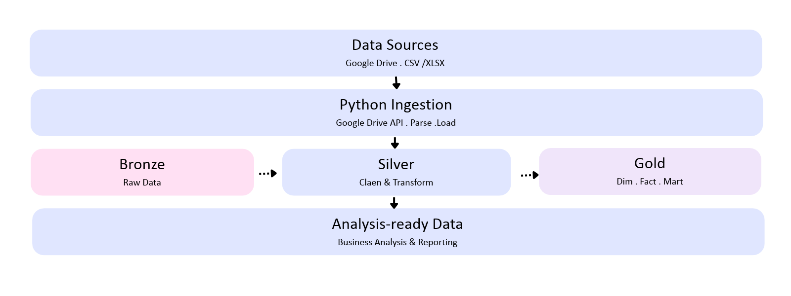

# End-to-End-Pipeline
*To understand how raw business data is collected, processed, transformed, and prepared for analysis.*

### I.Overview

An end-to-end data project that explores the complete data workflow, from collecting raw business data to transforming it into structured, analysis-ready datasets for business reporting.

**Key Objectives**
- Collect data from Google Drive using Python and Google Service Account authentication.
- Process and integrate multiple CSV and XLSX files.
- Clean, transform, and validate data using SQL.
- Build a structured data warehouse following the Medallion Architecture (Bronze, Silver, Gold).
- Prepare data for business analysis and reporting.

**Processing Workflow**


**Project Architecture** 

The project follows the Medallion Architecture to organize data processing into three layers:

- **Bronze:** Stores raw data ingested from multiple sources.
- **Silver:** Cleans, standardizes, and transforms raw data using SQL, with data quality checks.
- **Gold:** Builds analytical data models using SQL Views, including Dimension, Fact, and Mart views to support business analysis and reporting.

Python handles data ingestion, while SQL is used for data transformation, validation, and data warehouse development.

### II. Data Overview

**Data Sources**

The project works with 10 source files in CSV and XLSX formats, collected from Google Drive. These files contain business data related to the operations of a distribution company.

**Data Domains**

The source data covers multiple business domains:

| Data Domain | Description |
|---|---|
| Sales Transactions | Sales transaction records |
| Sales Targets | Sales plans and target adjustments |
| Customer | Customer information |
| Product | Product master data |
| Distributor | Distributor information and orders |
| Employee | Employee information |
| Territory | Sales territory mapping |
| Promotion | Promotional program information |
| Returns | Product return transactions |

**Data Characteristics**

- **Multiple Data Sources:** Data is distributed across different CSV and Excel files.
- **Different Data Structures:** Includes transactional data, master data, and planning data.
- **Relational Data:** Business entities are connected through common identifiers such as customer, product, distributor, and employee IDs.
- **Data Quality Challenges:** Requires handling missing values, inconsistent records, and data standardization before analysis.

### III. Tech Stack


| Technology | Purpose |
|---|---|
| Python | Data ingestion and file processing |
| SQL | Data transformation, modeling, and quality testing |
| PostgreSQL | Data storage and data warehouse |
| Google Drive API | Accessing and retrieving source files |
| Visual Studio Code | Development environment |
| Git & GitHub | Version control and project management |

### IV. Project Structure

```text
Structure/
│
├── 01_ingestion/
│   ├── connectors/       # Google Drive connection
│   ├── loaders/          # Data loading scripts
│   └── utils/            # File parsing and database utilities
│
├── 02_sql_analytics/
│   ├── raw/              # Bronze layer SQL scripts
│   ├── stg/              # Silver layer SQL scripts and data quality tests
│   └── gold/
│       ├── dim/          # Dimension views
│       ├── fact/         # Fact views
│       └── mart/         # Analytical mart views
│
└── .gitignore
```
### V. Setup & Execution

**Step 1: Clone the Repository**

```bash
git clone <repository-url>
cd End-to-end-pineline
```

**Step 2: Set Up the Python Environment**

```bash
# Create a virtual environment
python -m venv venv

# Activate the environment (Windows)
venv\Scripts\activate
```

Install the required Python libraries before running the ingestion scripts.

**Step 3: Configure Connections**

***Google Drive API***
- Set up Google Service Account authentication.
- Place the service account credentials in the `credentials/` directory.
- Grant the service account access to the source data folder on Google Drive.

***PostgreSQL***
- Create a PostgreSQL database.
- Configure database connection parameters in the `.env` file.

**Step 4: Execute the Data Workflow**

*Step 4.1 – Data Ingestion*
- Run individual Python loader scripts in `01_ingestion/loaders/` to retrieve source files from Google Drive and load raw data into PostgreSQL.

*Step 4.2 – Data Transformation*
- Execute SQL scripts in `02_sql_analytics/raw/` to prepare the Bronze layer.
- Run SQL scripts in `02_sql_analytics/stg/` to create and transform Silver datasets.

*Step 4.3 – Data Quality Validation*
- Execute `test_after_transform.sql` to validate the transformed datasets.
- Refer to `data_issues.md` for documented data quality issues.

*Step 4.4 – Analytical Data Modeling*
- Execute SQL scripts in `02_sql_analytics/gold/` to create Dimension, Fact, and Mart views for business analysis and reporting.

### VI. Conclusion

This project demonstrates an end-to-end data preparation workflow, from raw data ingestion to analytical data modeling. Through this project, I gained hands-on experience in using Python and SQL to process, validate, and organize business data into structured datasets ready for analysis and reporting.
